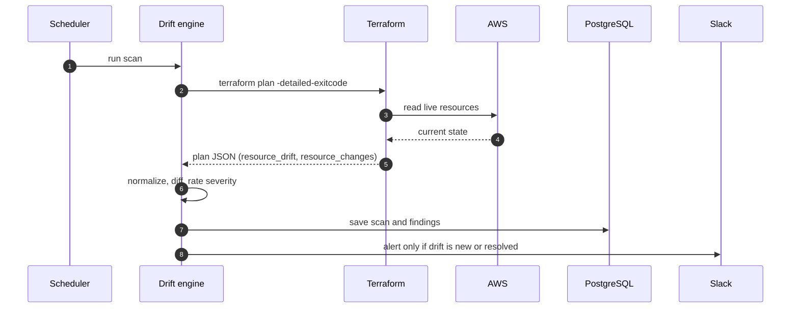
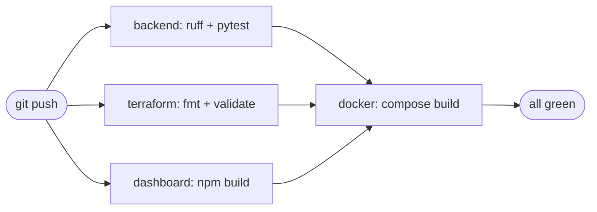

<p align="center">
  
</p>

<p align="center">
  <a href="https://github.com/Aash1B/Drift-Detector/actions/workflows/ci.yml"></a>
  
  
  
  
  
  
  
</p>

<p align="center">
  <b>Your Git repo says one thing. Your cloud does another.</b><br>
  This project finds the difference, rates how dangerous it is, tells your team, and shows it all on a live dashboard.
</p>

<p align="center">
  <a href="#why-this-exists">Why</a> &bull;
  <a href="#live-demo">Live demo</a> &bull;
  <a href="#features">Features</a> &bull;
  <a href="#how-it-works">How it works</a> &bull;
  <a href="#quick-start">Quick start</a> &bull;
  <a href="#severity-policy">Severity</a> &bull;
  <a href="#api">API</a> &bull;
  <a href="#tests-and-ci">CI</a> &bull;
  <a href="#roadmap">Roadmap</a>
</p>

---

## Why this exists

In **GitOps**, Git is the single source of truth: the desired state of your infrastructure lives in Terraform files. But real clouds drift. Someone opens a port in the console to debug something and forgets to close it. A hotfix never reaches Git. Nobody notices until something breaks, or gets breached.

| Without drift detection | With this project |
|---|---|
| Manual changes stay invisible for weeks | Found on the next scan (every few minutes) |
| Raw `terraform plan` output is long and noisy | One clean finding per resource, with a plain-English reason |
| A tag change and an open SSH port look the same | Ranked **Critical / High / Medium / Low** by an editable policy |
| Nobody is told | Slack alert, only when something is new, and again when it is fixed |
| No history | Every scan stored in PostgreSQL, with a trend chart |

## Live demo

Watch one full cycle: the stack starts, a risky change appears, it is detected, alerted, and finally resolved.

<p align="center">
  
</p>

> [!NOTE]
> The animation above is a stylised replay of a real test run: scan 5 resolved the SSH rule and scan 9 detected it again, exactly as the trend chart on the dashboard shows.

## Features

| | |
|---|---|
| :mag: **Real drift detection** | Runs `terraform plan` against the live AWS account and reads the JSON plan, so Terraform itself is the source of truth for what changed. |
| :broom: **Noise filtering** | Treats `null`, empty strings and empty lists as equal and compares rule lists as sets, so only real differences are reported. |
| :bust_in_silhouette: **Manual vs code change** | Tells you whether someone changed the cloud by hand, or the code simply has not been applied yet. |
| :traffic_light: **Severity policy in YAML** | Security staff can change what is Critical or Low by editing one file. No code changes needed. |
| :bell: **Smart Slack alerts** | A fingerprint per change means you are alerted only when drift is **new**, and told when it is **resolved**. No spam. |
| :bar_chart: **React dashboard** | Severity cards, side-by-side diffs (*Live in AWS* vs *Desired in Git*), trend chart, scan history and alerts. Refreshes every 10 seconds. |
| :floppy_disk: **History in PostgreSQL** | Scans, findings and alerts are stored, with the raw diff kept as queryable JSONB. |
| :whale: **One-command start** | Docker Compose runs the database, API, scheduler and dashboard together. |

## How it works

Watch the data move: Git, the live cloud and the scheduler feed the engine. The engine stores results, raises alerts, and the API feeds the dashboard.

<p align="center">
  
</p>

1. A **trigger** fires: the scheduler every N minutes, or the *Run scan now* button.
2. The engine runs `terraform plan -detailed-exitcode` (exit code `0` = clean, `1` = error, `2` = differences).
3. The plan is exported with `terraform show -json`. Its `resource_drift` section lists **manual changes**; `resource_changes` lists what Terraform would change to match the code.
4. The analyzer **normalises** the data, computes field-level differences and **rates** each one using `policies/rules.yaml`.
5. Findings are saved to **PostgreSQL**. The alert service compares the scan with the previous one and posts to **Slack** only if something is new or resolved.
6. The **dashboard** reads everything through the **FastAPI** endpoints.

<details>
<summary><b>Click to see the same flow as a sequence diagram</b></summary>



</details>

## Quick start

> [!IMPORTANT]
> You need **Docker Desktop**, **Terraform**, **Git** and an AWS account with an IAM user and access keys. The demo creates only free-tier resources (an S3 bucket and security groups).

<details open>
<summary><b>1. Get the code and configure it</b></summary>

```bash
git clone https://github.com/Aash1B/Drift-Detector.git
cd Drift-Detector
cp .env.example .env        # Windows PowerShell: Copy-Item .env.example .env
```

Open `.env` and set a database password and your AWS keys. Then pick a **globally unique** bucket name in `infra-repo/terraform.tfvars`.

</details>

<details open>
<summary><b>2. Create the demo infrastructure</b></summary>

```bash
cd infra-repo
terraform init
terraform apply        # type: yes
cd ..
```

</details>

<details open>
<summary><b>3. Start everything</b></summary>

```bash
docker compose up -d --build
```

| Service | URL |
|---|---|
| Dashboard | http://localhost:5173 |
| API docs (try every endpoint) | http://localhost:8000/docs |
| Database viewer | http://localhost:8080 |

</details>

> [!TIP]
> Open the API docs at `/docs` and click **POST /scans &rarr; Try it out &rarr; Execute** to run a scan without the dashboard.

### Try it yourself

- [ ] Open the dashboard and click **Run scan now**. It should show **no drift**.
- [ ] In the AWS console, open the demo security group and add an inbound **SSH** rule from `0.0.0.0/0`.
- [ ] Click **Run scan now**. A **Critical** finding appears (and a Slack alert, if configured).
- [ ] Expand the finding to see *Live in AWS* next to *Desired (Git)*.
- [ ] Remove the rule and scan again. The finding disappears and Slack says it was **resolved**.
- [ ] Clean up with `terraform destroy` inside `infra-repo`.

## Severity policy

Rules live in [`policies/rules.yaml`](policies/rules.yaml), so they can be changed without touching code. When several rules match, the **highest severity wins**.

| Level | When | Example |
|---|---|---|
| :red_circle: **Critical** | A sensitive port (22, 3389, 3306, 5432) is open to `0.0.0.0/0` outside Git | SSH open to the internet |
| :orange_circle: **High** | Any other inbound rule added outside Git; resource deleted or unmanaged; S3 access or encryption changed | New port 8080 rule |
| :yellow_circle: **Medium** | Inbound rule removed outside Git; S3 versioning or logging changed | HTTPS rule deleted |
| :blue_circle: **Low** | Tags changed | `Environment: dev` became `prod` |

<details>
<summary><b>See an example rule</b></summary>

```yaml
- name: Sensitive port opened to the internet
  severity: critical
  resource_type: aws_security_group
  path: ingress
  kind: extra_in_live
  item_match:
    from_port: [22, 3389, 3306, 5432]
    cidr_blocks_contains: "0.0.0.0/0"
```

</details>

## Dashboard

The React dashboard shows:

- **Severity cards** for the latest scan (Critical, High, Medium, Low) and the last scan status
- **Current drift** as expandable cards with *manual change* or *code change* badges and a side-by-side diff
- **Findings per scan** trend chart, which shows exactly when drift appeared and when it was fixed
- **Scan history** with trigger (manual or scheduled), status and number of findings
- **Recent alerts** with channel and delivery status
- A **Run scan now** button for on-demand scans

<!--
Add a real screenshot here once you have one:
1. Save it as docs/assets/dashboard.png
2. Remove the comment markers around the line below

<p align="center"></p>
-->

## API

| Endpoint | Purpose |
|---|---|
| `GET /health` | Liveness check |
| `POST /scans` | Run a scan now and store it |
| `GET /scans`, `GET /scans/{id}` | Scan history and one scan with its findings |
| `GET /findings` | Findings of the latest scan (optional `severity`, `scan_id`) |
| `GET /alerts` | Alert history |
| `GET /stats` | Dashboard summary and trend |

<details>
<summary><b>Try it from the command line</b></summary>

```bash
curl http://localhost:8000/health
curl -X POST http://localhost:8000/scans          # takes 10-20 seconds
curl http://localhost:8000/stats
curl "http://localhost:8000/findings?severity=critical"
```

</details>

## Configuration

<details>
<summary><b>All settings in <code>.env</code></b></summary>

| Variable | Meaning |
|---|---|
| `POSTGRES_USER`, `POSTGRES_PASSWORD`, `POSTGRES_DB` | Database credentials |
| `DATABASE_URL` | Connection string when running without Docker |
| `SLACK_WEBHOOK_URL` | Slack incoming webhook. Leave empty to disable Slack. |
| `SCAN_INTERVAL_MINUTES` | Scan frequency. `0` turns the scheduler off. |
| `ALERT_MIN_SEVERITY` | Lowest severity that triggers a Slack alert (`low` to `critical`) |
| `AWS_ACCESS_KEY_ID`, `AWS_SECRET_ACCESS_KEY`, `AWS_DEFAULT_REGION` | Credentials Terraform uses inside Docker |

</details>

## Project structure

<details>
<summary><b>Show the folder layout</b></summary>

```
drift-detector/
├── backend/
│   ├── app/
│   │   ├── detectors/terraform.py     run terraform plan, parse the JSON plan
│   │   ├── engine/diff.py             normalise data, field-level diff
│   │   ├── engine/analyzer.py         findings and severity rules
│   │   ├── services/scan_service.py   run a scan and store it
│   │   ├── services/alert_service.py  fingerprints and Slack alerts
│   │   ├── db/                        SQLAlchemy models and session
│   │   ├── scheduler.py               interval scans
│   │   └── main.py                    FastAPI endpoints
│   └── tests/                         pytest unit tests
├── dashboard/                         React + Vite + Tailwind + Recharts
├── infra-repo/                        Terraform code that is monitored
├── policies/rules.yaml                severity rules
├── docs/assets/                       animated README graphics
├── docker-compose.yml
└── .github/workflows/ci.yml
```

</details>

## Tests and CI

```bash
cd backend
pip install -r requirements.txt -r requirements-dev.txt
pytest -q
```

Every push runs four jobs on GitHub Actions:



<details>
<summary><b>Run without Docker (development mode)</b></summary>

```bash
cd backend
python -m venv venv
venv\Scripts\activate            # macOS/Linux: source venv/bin/activate
pip install -r requirements.txt
uvicorn app.main:app --reload

# in a second terminal
cd dashboard
npm install
npm run dev
```

</details>

## Security

> [!WARNING]
> Treat the Slack webhook URL, database password and AWS keys like passwords. They live only in `.env`, which is excluded from Git. Terraform state files can contain sensitive values and are excluded too.

- The demo IAM user has broad S3 and EC2 permissions for convenience. For real use, give the scanner a **read-only role** and keep write access for a separate, approved remediation role.
- CORS allows only the dashboard origin.
- All demo resources are free tier. Run `terraform destroy` when you are done.

## Roadmap

- [x] Terraform plan JSON processing and drift engine
- [x] Noise filtering and field-level diffs
- [x] YAML severity policy
- [x] PostgreSQL storage and FastAPI REST API
- [x] Scheduler and de-duplicated Slack alerts
- [x] React dashboard
- [x] Docker Compose packaging, tests and GitHub Actions CI
- [ ] Remediation: revert drift, or open a Pull Request to accept it
- [ ] Scans triggered by Git push webhooks
- [ ] Kubernetes manifest drift
- [ ] Dashboard login and roles
- [ ] Prometheus metrics

---

<p align="center">
  Built with Terraform, FastAPI, PostgreSQL, React and a healthy fear of unreviewed console changes.<br>
  <sub>If this helped you, a star on the repo is always appreciated.</sub>
</p>
